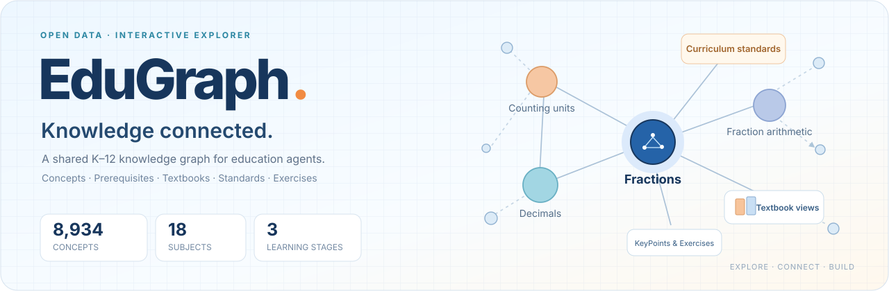
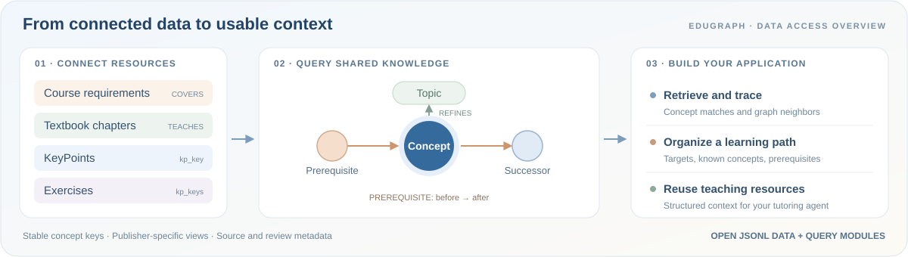
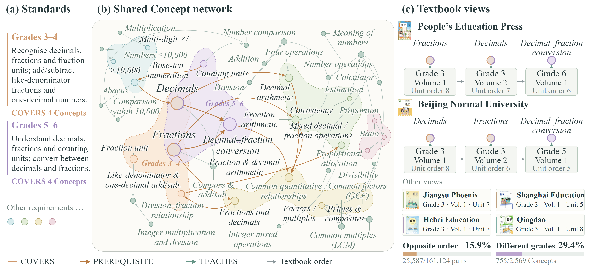
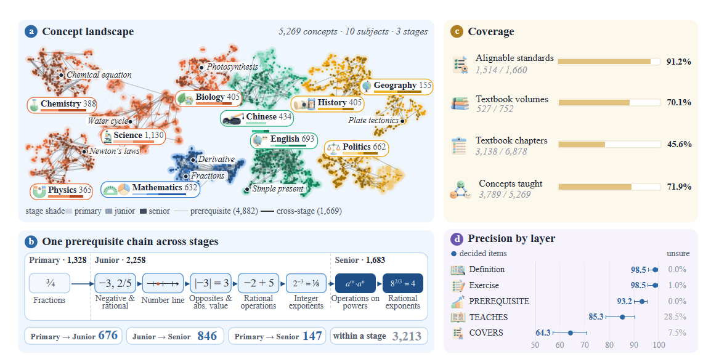

<a id="top"></a>

<div align="center">

<a href="https://openraiser.github.io/EduGraph/">
  
</a>

# EduGraph

**Connected Knowledge for Education Agents**

面向教育 Agent 的开放知识图谱与数据基础设施。<br>
让课程标准、知识点、先修关系、教材、讲解与习题，在同一张图中相连。

<p>
  <a href="https://openraiser.github.io/EduGraph/"></a>
  
  
  
  <a href="LICENSE-DATA"></a>
  <a href="LICENSE"></a>
</p>

<p>
  <a href="https://openraiser.github.io/EduGraph/"><b>🌐 在线探索</b></a> ·
  <a href="https://openraiser.github.io/EduGraph/downloads/edugraph-v0.31.0.tar.gz"><b>📦 下载数据</b></a> ·
  <a href="#features"><b>✨ 核心能力</b></a> ·
  <a href="#integration"><b>🔌 接入应用</b></a> ·
  <a href="#quickstart"><b>🚀 本地运行</b></a>
</p>

<sub>展示插图保留论文与早期网站快照；当前规模以本文数据概览和下载包 manifest 为准。</sub>

</div>

---

<a id="why-edugraph"></a>

## 🎯 为什么需要 EduGraph？

一次教学任务通常需要同时回答：**这个知识点是什么？学它之前需要会什么？在哪本教材中讲？可以用什么题目练习？**

EduGraph 以共享的 Concept 标识连接课程要求、先修关系和教学资源，让一次检索能够沿着明确的关系继续探索：

- **知识有联系**：Topic 组织内容层级，PREREQUISITE 表达知识依赖，帮助定位前置知识与后续学习目标。
- **教材有视角**：不同出版社的年级、册次和章节编排映射到同一套 Concept，便于对照教学安排。
- **资源可复用**：讲解、习题、课标和教材映射保留关联标识，可用于检索、备课以及教育 Agent 的上下文构建。

**EduGraph 提供可查询、可追溯的知识与资源；接入它的教育应用据此组织教学。**

<p align="center">
  
</p>

<table>
  <tr>
    <td width="33%" valign="top">
      <h3>🔎 探索知识</h3>
      <p>从一个知识点出发，查看关联知识、讲解与习题，按目标组织学习顺序。</p>
      <a href="https://openraiser.github.io/EduGraph/">打开图谱浏览器 →</a>
    </td>
    <td width="34%" valign="top">
      <h3>📚 对照教材</h3>
      <p>围绕同一知识点比较不同教材的年级、册次、章节位置与教学角色。</p>
      <a href="#guided-tour">查看使用步骤 →</a>
    </td>
    <td width="33%" valign="top">
      <h3>🛠️ 构建应用</h3>
      <p>下载 JSONL 数据，复用检索与图查询模块，为自己的教育应用准备上下文。</p>
      <a href="#integration">查看接入示例 →</a>
    </td>
  </tr>
</table>

<details>
<summary><b>📋 内容导航</b></summary>

- [从一个知识点开始](#guided-tour)
- [核心能力](#features) · [数据概览](#data)
- [本地运行](#quickstart) · [接入你的教育应用](#integration)
- [数据如何组织](#data-layout) · [语义与使用说明](#usage-notes)
- [发布与复现](#deployment)
- [参与贡献](#contributing) · [引用与归属](#citation) · [许可与致谢](#license)

</details>

<a id="guided-tour"></a>

## 🌐 从一个知识点开始

在 [EduGraph Explorer](https://openraiser.github.io/EduGraph/) 中搜索知识点，点击节点即可查看前置知识、后继知识、讲解、例题、课标与教材编排。无需登录，无需安装。

<p align="center">
  <a href="https://openraiser.github.io/EduGraph/"></a>
  <br><sub>左侧检索 · 中间探索知识关系与教材编排 · 右侧查看关联教学资源</sub>
</p>

| 从哪里开始？ | 可以看到什么？ |
|:---|:---|
| [**分数** →](https://openraiser.github.io/EduGraph/#/concept/mathematics.primary.number-and-algebra.number-and-operations.decimals-and-fractions.fractions) | 从知识关系出发，查看例题与不同出版社的教材位置。 |
| [**小数与分数的互化** →](https://openraiser.github.io/EduGraph/#/concept/mathematics.primary.number-and-algebra.number-and-operations.decimals-and-fractions.decimal-fraction-conversion) | 查看先修依赖，并根据已掌握的知识生成学习顺序。 |
| [**关于数据集** →](https://openraiser.github.io/EduGraph/#/about) | 浏览知识全景、跨学段关系与数据说明，下载完整公开包。 |

**试一试「分数」：**

1. 打开上面的知识点链接，在中间切换前置、后继或全部关系，点击邻居节点继续探索。
2. 在右侧切换讲解、例题、教材与课标；进入教材编排视图，对照人教版、北师大版等教材的位置。
3. 选择学习目标，打开学习路径并标记已掌握知识；也可以复制知识点链接或导出单点 JSON，与他人分享。

<a id="features"></a>

## ✨ 一张图，连接六类信息

| | 能力 | 在浏览器里做什么 |
|:---:|:---|:---|
| 🔎 | **知识检索** | 中文搜索、学科与学段筛选、Topic 层级导航。 |
| 🕸️ | **关系探索** | 展开 1–3 跳前置/后继关系，点击、拖动和缩放局部知识图。 |
| 🧭 | **学习路径** | 选择目标，结合已掌握集合，生成满足先修约束的可行顺序。 |
| 📚 | **教材视图** | 对照不同出版社的册次与章节顺位，查看匹配的教材参考封面。 |
| ✏️ | **讲解与习题** | 查看 KeyPoints、例题、答案解析及关联课标。 |
| 📦 | **开放数据** | 分享知识点链接、导出单点 JSON、下载完整 JSONL 数据与校验文件。 |

<p align="center">
  <a href="https://openraiser.github.io/EduGraph/#/about"></a>
  <br><sub>课标连接共享知识网络；不同教材保留各自的组织视图。</sub>
</p>

<a id="data"></a>

## 📊 数据概览

当前 **v0.31.0 公开预览（public-preview）**覆盖 **18 个学科、3 个学段、41 个知识图谱学科—学段分区**。以下为主图的精确计数；独立来源目录视图另列。网页另提供小学艺术的来源目录分区，知识点分区数量保持 41。新增 Concept、先修关系与教学资源保留各自的来源和审核状态。

**覆盖学科**：数学、语文、英语、物理、化学、生物、历史、地理、道德与法治/思想政治、科学、信息技术、音乐、美术、艺术、日语、俄语、体育与健康、通用技术。v0.28.0 新增初中日语、小学体育与健康、初中体育与健康三个分区，并扩充九门高中学科。**日语与俄语覆盖初中和高中；体育与健康、音乐、美术覆盖小学、初中和高中**；艺术覆盖初中和高中，通用技术覆盖高中。全图覆盖三学段，不表示每门学科均覆盖三个学段。

| 知识与关系 | 数量 | 教学资源 | 数量 |
|:---|---:|:---|---:|
| Concept · 知识点 | **8,938** | KeyPoint · 讲解要点 | **19,562** |
| Topic · 主题 | **1,676** | Exercise · 习题 | **10,795** |
| PREREQUISITE · 先修关系 | **6,447** | StandardItem · 课标条目 | **5,463** |
| REFINES · 分类层级 | **10,303** | Textbook · 教材册次 | **1,161** |
| COVERS · 课标关联 | **13,636** | Chapter · 教材章节 | **12,607** |
| TEACHES · 教材关联 | **23,411** | Subject / Stage · 学科 / 学段 | **18 / 3** |

### 🌱 本轮扩充 v0.31.0：教材来源视图与学习资源补齐

相较上一公开版 v0.29.0，新增 **584 份独立教材来源视图、6,761 个来源目录节点、2,307 条来源章节—知识点关联**。新增或补齐目录的来源共 **601 份**，其中包括 17 份已有视图。每份来源保持自己的章节层级和顺序，关联仍使用现有 TEACHES 类型及共享 Concept 标识。

主图新增 **4 个小学科学 Concept（水能、风能、潮汐能、生物质能）、33 条讲解要点、23 道习题、79 条 COVERS 和 4 条 REFINES**，既有记录完整保留。资源补齐同时服务新增知识点和已有知识点；讲解、习题沿用原构建流水线生成与机器复核。主图教材册次、章节和先修关系数量保持不变。

### 🌿 历史扩充 v0.29.0：补齐英语、科学与道德法治学习内容

相较 v0.28.0，本轮通过原构建流水线新增 **42 个 Concept、84 条讲解要点、42 道习题、18 个课标条目、130 条 COVERS、42 条 REFINES 和 4 条先修关系**。已有 8,892 个 Concept 及其资源、标识和关系完整保留。

| 扩充范围 | 新增 Concept | 新增讲解要点 | 新增习题 |
|:---|---:|---:|---:|
| 小学、初中英语 | 36 | 72 | 36 |
| 小学科学 | 3 | 6 | 3 |
| 小学、初中道德与法治 | 3 | 6 | 3 |
| 合计 | **42** | **84** | **42** |

新增知识点均关联课标、讲解和习题；讲解与习题经过逐条模型复核，发现的错挂题通过原出题步骤重新生成并复核。先修关系在全图上下文中生成候选，再核对语义和无环结构。新增课标包含经原文核实的小学学段投影，保留旧条目与旧关联的身份。本轮教材、章节与 TEACHES 数量沿用 v0.28.0。

### 🌿 历史扩充 v0.28.0：1,580 条课标接入完整构建流程

相较 v0.27.0，该轮将 **1,580 条课标要求**接入原构建流程，新增 **1,703 个 Concept、166 个 Topic、3,686 条讲解要点、1,703 道习题和 510 条先修关系**，同时新增 **3,125 条 COVERS、1,834 条 REFINES**。课标组织层另增 151 个主题、561 个子主题。

| 扩充范围 | 新增 Concept | 新增讲解要点 | 新增习题 |
|:---|---:|---:|---:|
| 初中日语 | 108 | 222 | 108 |
| 小学、初中体育与健康 | 265 | 547 | 265 |
| 高中语文、英语、历史、生物、化学、物理、数学、地理、思想政治 | 1,330 | 2,917 | 1,330 |
| 合计 | **1,703** | **3,686** | **1,703** |

- **课标驱动生成**：经候选生成、去重合并、讲解与习题生成、模型复核和返修后，按现有 JSONL 结构接入共享知识图谱。
- **资源与关系衔接**：每个新增 Concept 均有关联课标、讲解和习题；先修关系通过语义核对和无环检查。新增讲解与习题为模型生成并复核的内容。
- **保留既有数据**：原有 7,189 个 Concept 的标识、节点内容及既有资源和关系完整保留。教材层与独立来源视图沿用上一版，新增知识点不自动宣称已有教材关联。

### 🌿 历史扩充 v0.27.0：加入初中俄语

相较 v0.26.0，v0.27.0 依据《义务教育俄语课程标准（2022年版）》新增 **127 个 Concept、12 个 Topic、101 个课标条目**，配套 **269 条讲解要点、127 道习题、62 条先修关系、187 条 COVERS 和 135 条 REFINES**。课标组织层另增 4 个主题、8 个子主题。

| 俄语范围 | Concept | 讲解要点 | 习题 |
|:---|---:|---:|---:|
| 初中（v0.27.0 新增） | 127 | 269 | 127 |
| 高中（原样保留） | 108 | 230 | 108 |
| 俄语合计 | **235** | **499** | **235** |

- **资源覆盖**：新增 127 个 Concept 均有讲解和习题；保留的新增资源已完成机器复核，未声称教师审核。
- **课标可追溯**：101 个新增 StandardItem 中，93 个已有 COVERS 关联；其余 8 个保留为明确的覆盖缺口，不以知识点资源齐全替代课标覆盖率。
- **衔接已有数据**：原有 7,062 个 Concept 及其既有资源和关系原样保留；教材册次、章节、TEACHES 与独立来源视图延续上一版。初中俄语新增 Concept 不自动声明已有教材映射。

### 🌿 历史扩充 v0.26.0：更多学科，补齐学习资源

v0.26.0 相较 v0.25.0 新增 **1,313 个 Concept、134 个 Topic、691 个课标条目**，并为此前缺少讲解与习题的 **311 个已有 Concept** 补齐资源。该轮讲解要点净增 **3,387 条**，习题新增 **1,624 道**。下表记录 v0.26.0 的扩充范围和当时规模。

| 扩充学科 | 新增 Concept | v0.26.0 Concept | v0.26.0 讲解要点 | v0.26.0 习题 |
|:---|---:|---:|---:|---:|
| 通用技术 | +380 | 380 | 807 | 380 |
| 美术 | +233 | 390 | 791 | 390 |
| 体育与健康 | +218 | 218 | 474 | 218 |
| 日语 | +140 | 140 | 295 | 140 |
| 俄语 | +108 | 108 | 230 | 108 |
| 音乐 | +100 | 192 | 388 | 192 |
| 艺术 | +86 | 148 | 302 | 148 |
| 语文（书法内容） | +32 | 466 | 1,006 | 602 |
| 信息技术 | +16 | 185 | 373 | 185 |

- **沿用原构建流程**：从官方课标要求生成候选，经去重与核对后写入既有 Concept / Topic 结构；讲解、习题和先修提案通过原流水线的真实模型 API 生成，并执行机器复核与关系检查。
- **资源补齐**：该轮新增及补齐范围内，每个 Concept 均有讲解与习题；音乐、美术、艺术已具备这两类资源及先修关系。讲解与习题为模型生成内容，并非教材正文摘录。
- **课标可追溯**：新增 691 个 StandardItem 对应 662 条独立原文要求及 29 条学段投影；COVERS 净增 1,839 条。课标条目数与独立来源要求数分别统计。
- **衔接已有数据**：该轮保留原有 5,749 个 Concept 的标识与节点内容；先修图经传递归约后保留原有可达关系。教材册次、章节、TEACHES 与独立来源视图原样延续；新增 Concept 不自动声明已有教材映射。

### 📚 教材范围扩充

此前 **v0.24.0** 接入 ChinaTextbook 中既有十学科的一批主教材来源；相较 v0.21.0，该批增加 **361 册教材、4,048 个目录节点和 1,044 条 TEACHES**。随后信息技术扩充增加 48 册教材、1,681 个目录节点和 396 条 TEACHES。本轮保留这些教材数据，**不将知识点扩充等同于 ChinaTextbook 全部资源已覆盖**。

- **1,203 份独立来源视图**：含 **11,212 个目录节点、2,666 条 TEACHES**；992 份视图具有已恢复的目录。不同 PDF 来源的目录独立保存，能够确认主图教材候选时通过辅助索引连接。
- **来源覆盖达到 1,612 / 2,046（78.8%）**：以冻结的 ChinaTextbook 非大学来源清单为分母；包括 1,203 份独立视图及 409 份已直接接入主图的来源。这是来源条目的接入比例，不是教材版次或正文知识点的完整覆盖率。
- **知识点共享、目录独立**：每份视图保留自身目录层级和顺序，TEACHES 指向主图 Concept；可在同一个知识点下比较不同教材来源的组织方式。
- **审核记录随数据保留**：新增关联经证据检查、知识点名称匹配或模型语义复核，通过的结果进入公开数据；不同阶段的审核字段保留在 JSONL 中。来源视图不作为主图教材册次数量的直接增量。

[查看来源视图与索引 →](data/source-views-v0.31.0/) · [字段与统计口径 →](DATA_CARD.md)

<p align="center">
  
  <br><sub>论文中的历史数据分析快照：图中知识点、学科、教材与覆盖率数字对应扩充前的数据；当前公开预览规模以上表和 manifest 为准。</sub>
</p>

📥 **[下载公开预览数据包](https://openraiser.github.io/EduGraph/downloads/edugraph-v0.31.0.tar.gz)** · [SHA-256 校验](https://openraiser.github.io/EduGraph/downloads/edugraph-v0.31.0.tar.gz.sha256) · [Data Card](DATA_CARD.md)

下载包同时包含 `v0.31.0/` 主图和 `source-views-v0.31.0/` 独立来源视图。两层共享知识点，且教材范围重叠，**不能直接相加作为数据集规模**。

<a id="quickstart"></a>

## 🚀 本地运行

只想浏览，直接打开 [在线 Explorer](https://openraiser.github.io/EduGraph/)；只需数据，直接 [下载公开预览包](https://openraiser.github.io/EduGraph/downloads/edugraph-v0.31.0.tar.gz)。开发或自部署可使用以下步骤。

需要 **Node.js ≥ 20.11** 和 `tar`。网页与构建工具无需安装 npm 依赖。

```bash
git clone https://github.com/OpenRaiser/EduGraph.git
cd EduGraph
npm run build
npm test
npm run dev
```

打开 **http://127.0.0.1:4173/EduGraph/**。首次构建会校验并解压公开数据包，生成检索索引和 41 个按学科、学段划分的资源文件。

<a id="integration"></a>

## 🔌 接入你的教育应用

复用仓库现有的检索与图查询模块，即可为 Agent 准备结构化上下文。模型调用、学生状态管理和教学策略由你的应用层接入。

| 应用需要 | EduGraph 提供 | 可用于 |
|:---|:---|:---|
| 找到相关知识 | 知识点名称、别名、学科与学段筛选 | 知识检索与候选节点召回 |
| 理解知识依赖 | 前置/后继关系、Topic 层级、可行学习顺序 | 前置知识回顾与学习路径展示 |
| 获得教学素材 | 讲解、习题及答案解析、课标与教材映射 | 备课、练习选择与检索增强上下文 |

下面的示例使用 **「小数与分数的互化」** 查询知识、资源及先修学习路径。先执行 `npm run build`，再将代码保存为仓库根目录的 `example.mjs`，运行 `node example.mjs`：

```javascript
import { readFile } from 'node:fs/promises';
import { createModel, findNodes } from './web/model.mjs';

const read = async file =>
  JSON.parse(await readFile(new URL(`./dist/${file}`, import.meta.url), 'utf8'));
const model = createModel(
  await read('data/graph.json'),
  await read('data/search.json')
);
const [concept] = findNodes(model, '小数与分数的互化', {
  subject: 'mathematics', stage: 'primary'
});
if (!concept) throw new Error('未找到知识点');

const manifest = await read('data/manifest.json');
const shard = await read(`data/resources/${concept.subject}/${concept.stage}.json`);
const known = []; // 已掌握知识点的 key，可由应用传入
const context = {
  release: manifest.version,
  concept,
  neighbors: model.graph.neighbors(concept.key, { k: 1 }),
  learningPath: model.graph.learningPath([concept.key], known),
  resources: shard.concepts[concept.id]
};
console.log(JSON.stringify(context, null, 2));
```

输出包含知识点、按跳数组织的前置/后继、学习路径，以及 `keypoints`、`exercises`、`standards`、`teaches` 四组关联资源。课标映射的 `from` 对应 `dist/data/standards.json` 中的 `id`；教材映射的 `from` 对应分区中的 `chapters[].chapter_id`，再由 `textbook_id` 关联教材册次。

持久化引用请保存 `concept.key`；`concept.id` 是当前构建内的索引。完整来源与审核字段可在原始 JSONL 包中查看，浏览器 JSON 为展示与查询选取了其中的字段。

<a id="data-layout"></a>

## 🗂️ 数据如何组织

```text
data/
  edugraph-v0.31.0.tar.gz      公开预览主图、来源视图及数据说明
  edugraph-v0.31.0.tar.gz.sha256
  source-views-v0.31.0/       独立来源视图与教材关联索引
    textbooks.jsonl         来源视图的教材元数据
    chapters.jsonl          各来源自己的目录层级与顺序
    teaches.jsonl           目录到已有 Concept 的候选关联
    source-links.jsonl      来源视图与主图教材的对应关系
    index.json              视图规模、范围说明与校验信息
  open/v0.31.0/              构建时解压，Git 忽略；通过归档分发
    knowledge-points/       Concept、Topic、REFINES、PREREQUISITE
    keypoints/              讲解要点
    exercises/              习题、答案与解析
    standards/              课标条目
    standards-alignment/    COVERS 关联
    textbook-alignment/     教材、章节与 TEACHES 关联
web/                        图谱浏览器、查询模块与展示素材
scripts/                    构建、预览、发布与线上验证
tests/                      真实数据与关联完整性测试
docs/assets/                README 展示素材
```

| 关系 | 方向 | 含义 |
|:---|:---|:---|
| `REFINES` | 子节点 → 父主题 | 组织知识的分类层级。 |
| `PREREQUISITE` | 前置 Concept → 后继 Concept | 表达知识依赖。 |
| `COVERS` | 课标条目 → Concept | 将课程要求绑定到共享知识。 |
| `TEACHES` | 教材章节 → Concept | 保留主讲、复习、提及等教学角色。 |

**资源也通过 Concept 标识连接**：讲解记录中的 `kp_key` 指向知识点；习题记录中的 `kp_keys` 保存题目关联的知识点列表。上表中的 `from` / `to` 则记录有方向的关系，可通过索引进行双向查询。各类文件的字段说明见 [Data Card](DATA_CARD.md)。

<a id="usage-notes"></a>

<details>
<summary><b>📖 语义与使用说明</b></summary>

- 教材编排顺序与先修关系分别保存；教材轨道的箭头不转换成先修边。
- 教材目录视图保留章节顺位与关联知识点，公开包未包含原书章节标题和印刷编号。
- 独立来源视图沿用 `Textbook`、`TextbookChapter`、`TEACHES` 类型；`source-links.jsonl` 是辅助索引，不新增知识点或先修边。系列匹配不等于完全相同出版版次；多个候选教材记录会保留歧义，不合并两套目录的教学顺序。
- 学习路径是先修约束下的一条可行顺序；已掌握标记仅保存在当前浏览器。
- 数据保留原始来源与审核状态。资源存在和关联正确性是不同指标，机器审核不表示人工核验。
- 日语、俄语覆盖初中和高中；体育与健康覆盖小学、初中和高中；通用技术覆盖高中。音乐、美术、艺术已有讲解与习题。教材关联仍按实际核对结果展示，缺少映射不表示原教材没有相应内容。
- 新增 Concept 保留草稿来源，新增先修边保留候选状态，COVERS 为自动匹配；本轮保留的新增讲解、习题已完成机器复核，未声称教师审核。完整范围与历史遗留状态见 Data Card。
- 教材参考封面按出版社、学科、系列与册次匹配，具体印次未逐一核验；点击封面可追溯来源。未匹配时使用文字封面。
- 完整公开数据包不含真实学生历史记录，浏览器也不向服务器上传学习标记。

</details>

<a id="deployment"></a>

## ⚙️ 发布与复现

| 分支 | 内容 |
|:---|:---|
| [`main`](https://github.com/OpenRaiser/EduGraph/tree/main) | 网页源码、公开数据、说明与构建脚本。 |
| [`gh-pages`](https://github.com/OpenRaiser/EduGraph/tree/gh-pages) | 自动生成的网站，可直接由 GitHub Pages 托管。 |

向 `main` 推送后，[GitHub Actions](https://github.com/OpenRaiser/EduGraph/actions/workflows/pages.yml) 自动构建、运行数据测试、检查发布文件范围并部署。随后访问线上资源，验证全部数据分片、检索与下载校验和。

```bash
npm run audit:site  # 检查可发布文件、来源记录和完整数据包
```

<a id="contributing"></a>

## 🤝 一起完善 EduGraph

欢迎通过 [Issues](https://github.com/OpenRaiser/EduGraph/issues) 反馈问题，或通过 Pull Request 提交改进：

- **数据纠错**：提供知识点 `key`、相关资源或关系的标识、公开数据版本，以及建议修改的依据。
- **浏览体验**：附上可复现的知识点链接、操作步骤与预期表现，帮助改进检索、图谱和教材视图。
- **接入示例**：分享基于公开数据的查询、教学资源组织或教育应用示例，注明依赖与运行方式。

<a id="citation"></a>

## 📝 引用与归属

使用公开数据时，请标注 **EduGraph、所用数据版本和数据许可**。下面是仓库资源的 BibTeX 引用，方便在研究或项目说明中使用：

```bibtex
TBD
```

<a id="license"></a>

## 🤝 许可与致谢

- **代码**：[Apache 2.0](LICENSE)
- **公开教育数据**：[CC BY-SA 4.0](LICENSE-DATA)，详细说明见 [Data Card](DATA_CARD.md)。
- **教材来源核对**：基于 [TapXWorld/ChinaTextbook](https://github.com/TapXWorld/ChinaTextbook/tree/e2b3f62213c77bb8c33c5be355f97625ea1b8b61) 的固定来源快照构建结构候选与关联。公开包不分发教材 PDF、正文、OCR 文本或原目录标题。
- **教材封面**：来自 [TapXWorld/ChinaTextbook](https://github.com/TapXWorld/ChinaTextbook)，保留每张图片的来源与匹配信息。封面版权归相应出版社及权利人，不随教育数据重新授予 CC BY-SA 许可，见 [封面来源说明](web/assets/covers/NOTICE.txt)。
- 项目展示风格参考 [PAGER](https://github.com/OpenRaiser/Pager) 与 [PaperFit](https://github.com/OpenRaiser/PaperFit)；README 的介绍与使用引导参考 [AgentPilot](https://github.com/HKUDS/AgentPilot) 的组织方式。

<div align="center">

**[进入 EduGraph →](https://openraiser.github.io/EduGraph/)** · [反馈与建议](https://github.com/OpenRaiser/EduGraph/issues) · [返回顶部 ↑](#top)

</div>
