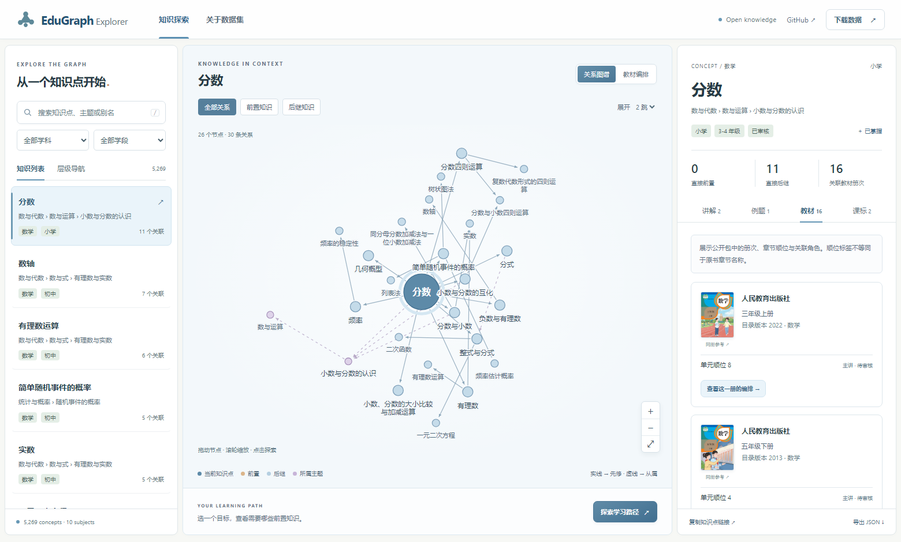

<a id="top"></a>

<div align="center">

<a href="https://openraiser.github.io/EduGraph/">
  
</a>

# EduGraph

**Connected Knowledge for Education Agents**

面向教育 Agent 的开放知识图谱与数据基础设施。<br>
连接课程要求、知识点、先修关系、教材、讲解与习题，让教学资源可检索、知识关系可探索。

<p>
  <a href="https://openraiser.github.io/EduGraph/"></a>
  
  
  <a href="LICENSE"></a>
  <a href="LICENSE-DATA"></a>
</p>

<p>
  <a href="https://openraiser.github.io/EduGraph/"><b>🌐 在线体验</b></a> ·
  <a href="https://openraiser.github.io/EduGraph/#/about"><b>📦 数据下载</b></a> ·
  <a href="#features"><b>✨ 核心能力</b></a> ·
  <a href="#quickstart"><b>🚀 快速开始</b></a> ·
  <a href="#integration"><b>🔌 接入应用</b></a>
</p>

### 从一个知识点出发，找到它的前置知识、教学资源与教材位置。

</div>

<a id="why-edugraph"></a>

## 🎯 为什么需要 EduGraph？

教育应用需要把课程要求、知识依赖和教学素材联系起来：教“分数”之前需要掌握什么？不同教材在哪里讲解？哪些讲解与习题可以用于这次教学？

EduGraph 以 **Concept（知识点）** 为共同标识，将这些信息组织成可查询的关系网络。应用可以先找到相关知识，再沿着关系检索所需资源，为讲解、练习选择和学习规划提供上下文。

<table>
  <tr>
    <td width="33%" valign="top">
      <h3>🕸️ 知识相连</h3>
      <p>Topic 组织知识层级，先修关系连接学习依赖。从局部知识点探索前置基础与后续目标。</p>
    </td>
    <td width="34%" valign="top">
      <h3>📚 多教材视角</h3>
      <p>不同教材共享知识点标识，同时保留各自的年级、册次和章节编排，支持教学位置对照。</p>
    </td>
    <td width="33%" valign="top">
      <h3>🔌 面向应用</h3>
      <p>开放结构化数据与检索模块，为教育 Agent、备课工具和学习应用提供可追溯的教学资源。</p>
    </td>
  </tr>
</table>

<a id="features"></a>

## ✨ 核心能力

### 🔎 检索与探索知识

- **按需检索**：中文关键词搜索，结合学科、学段筛选与 Topic 层级导航定位知识点。
- **查看知识依赖**：展开 1–3 跳前置与后继关系，点击、拖动、缩放图谱，继续探索相邻节点。
- **组织学习顺序**：指定目标及已掌握知识，生成满足先修约束的学习路径。

### 📚 在同一知识点下查看教学资源

- **讲解与练习**：查看 KeyPoints、例题、答案与解析。
- **课程要求**：关联中小学课程标准与大学教学大纲，查看知识点对应的学习要求。
- **教材对照**：比较不同出版社的册次、章节顺位与教学角色，切换独立教材目录视图。

### 🛠️ 复用数据，构建教育应用

- **开放数据**：下载 JSONL 数据包及 SHA-256 校验文件。
- **结构化查询**：复用 JavaScript 检索、邻域查询与学习路径模块，组装 Agent 所需上下文。
- **分享与部署**：复制知识点链接、导出单点 JSON，或自行部署静态图谱浏览器。

<a id="demo"></a>

## 🌐 EduGraph in Action

打开 [EduGraph Explorer](https://openraiser.github.io/EduGraph/) 即可使用，无需登录。

<p align="center">
  <a href="https://openraiser.github.io/EduGraph/"></a>
  <br><sub>左侧检索知识 · 中间探索关系与学习路径 · 右侧查看讲解、习题、课标与教材</sub>
</p>

| 体验入口 | 探索方式 |
|:---|:---|
| [**分数** →](https://openraiser.github.io/EduGraph/#/concept/mathematics.primary.number-and-algebra.number-and-operations.decimals-and-fractions.fractions) | 点击关联节点，查看讲解与例题，再对照不同教材中的教学位置。 |
| [**小数与分数的互化** →](https://openraiser.github.io/EduGraph/#/concept/mathematics.primary.number-and-algebra.number-and-operations.decimals-and-fractions.decimal-fraction-conversion) | 查看前置知识，标记已掌握内容，生成通向目标知识点的学习顺序。 |
| [**矩阵乘法** →](https://openraiser.github.io/EduGraph/#/concept/mathematics.university.linear-algebra.matrix.matrix-multiplication) | 探索大学线性代数中的知识依赖，查看讲解、习题与教学大纲。 |
| [**数据集与下载** →](https://openraiser.github.io/EduGraph/#/about) | 了解数据结构与规模，获取完整公开数据包。 |

<a id="quickstart"></a>

## 🚀 快速开始

**在线使用**：直接打开 [图谱浏览器](https://openraiser.github.io/EduGraph/)，搜索或选择一个知识点。

**获取数据**：进入 [数据集页面](https://openraiser.github.io/EduGraph/#/about)，点击「下载公开数据」获取 JSONL 数据及校验文件。数据字段与来源说明见 [Data Card](DATA_CARD.md)。

**本地运行**：需要 **Node.js ≥ 20.11** 和 `tar`；无需安装 npm 依赖。

```bash
git clone https://github.com/OpenRaiser/EduGraph.git
cd EduGraph
npm run build
npm run dev
```

在浏览器打开 **http://127.0.0.1:4173/EduGraph/**。构建程序自动解压数据包并生成检索索引与资源文件。

<a id="architecture"></a>

## 🧩 数据与技术结构

**共享知识层 → 关联资源层 → 应用查询层**：知识点与主题组成知识网络，教学资源通过稳定标识连接到知识点，查询模块将相关信息组织为应用上下文。

<p align="center">
  
</p>

| 关系或字段 | 连接方式 | 用途 |
|:---|:---|:---|
| `REFINES` | 子节点 → 父主题 | 组织知识分类与层级。 |
| `PREREQUISITE` | 前置 Concept → 后继 Concept | 查询学习依赖并规划学习顺序。 |
| `COVERS` | 课程要求条目 → Concept | 将课标或教学大纲中的学习要求绑定到知识点。 |
| `TEACHES` | 教材章节 → Concept | 记录教学位置及主讲、复习、提及等角色。 |
| `kp_key` / `kp_keys` | 讲解 / 习题 → Concept | 检索知识点对应的教学资源。 |

教材编排顺序与知识先修关系分别组织：前者保留每本教材的教学视角，后者表达共享知识网络中的学习依赖。

<a id="data"></a>

## 📊 数据概览

EduGraph 覆盖 **18 个学科**，知识网络横跨**小学、初中、高中和大学**。大学数学包括**线性代数、高等数学、概率论与数理统计、离散数学**。下表统计共享主图，教材来源视图单独列示。

| 知识与关系 | 数量 | 教学资源 | 数量 |
|:---|---:|:---|---:|
| Concept · 知识点 | **9,242** | KeyPoint · 讲解要点 | **20,215** |
| Topic · 主题 | **1,717** | Exercise · 习题 | **11,099** |
| PREREQUISITE · 先修关系 | **6,674** | StandardItem · 课程要求条目 | **5,631** |
| REFINES · 分类层级 | **10,644** | Textbook · 教材册次 | **1,161** |
| COVERS · 课程关联 | **13,956** | Chapter · 教材章节 | **12,607** |
| TEACHES · 教材关联 | **23,411** | Subject / Stage · 学科 / 学段 | **18 / 4** |

**独立教材来源视图**：1,217 份视图、11,738 个目录节点及 3,198 条章节—知识点关联。每个来源保留独立的目录结构，并通过共享知识点与主图连接。

<details>
<summary><b>查看覆盖学科</b></summary>

数学、语文、英语、物理、化学、生物、历史、地理、道德与法治 / 思想政治、科学、信息技术、音乐、美术、艺术、日语、俄语、体育与健康、通用技术。

具体学科与学段的收录范围见 [Data Card](DATA_CARD.md)。

</details>

<a id="integration"></a>

## 🔌 接入你的教育应用

EduGraph 提供数据与查询能力。教育 Agent 可以围绕目标知识点检索先修知识、课程要求和教学资源，再结合自身的模型与学习者状态选择教学动作。

先执行 `npm run build`，将下面代码保存为仓库根目录的 `example.mjs`，运行 `node example.mjs`：

```javascript
import { readFile } from 'node:fs/promises';
import { createModel, findNodes } from './web/model.mjs';

const read = async file =>
  JSON.parse(await readFile(new URL(`./dist/${file}`, import.meta.url), 'utf8'));
const model = createModel(
  await read('data/graph.json'),
  await read('data/search.json')
);
const [concept] = findNodes(model, '小数与分数的互化', {
  subject: 'mathematics', stage: 'primary'
});
if (!concept) throw new Error('未找到知识点');

const shard = await read(`data/resources/${concept.subject}/${concept.stage}.json`);
const known = []; // 由应用传入已掌握知识点的 key
const context = {
  concept,
  neighbors: model.graph.neighbors(concept.key, { k: 1 }),
  learningPath: model.graph.learningPath([concept.key], known),
  resources: shard.concepts[concept.id]
};
console.log(JSON.stringify(context, null, 2));
```

输出包含知识点、前置与后继邻域、学习路径，以及讲解、习题、课标和教材关联。持久化引用使用 `concept.key`；`concept.id` 用于当前构建的资源索引。

<a id="code-structure"></a>

## 📖 项目结构

```text
EduGraph/
├── data/                 公开数据包、教材来源视图与数据配置
├── web/                  图谱浏览器
│   ├── core/             检索、知识关系与学习路径模块
│   ├── model.mjs         浏览器数据模型与查询接口
│   └── assets/           网站图示与教材参考封面
├── scripts/              构建、本地预览与发布验证
├── tests/                检索、资源关联和数据完整性检查
├── docs/assets/          项目介绍素材
└── DATA_CARD.md          数据字段、来源与使用说明
```

开发时可运行 `npm test` 检查数据与查询功能，运行 `npm run audit:site` 检查网站产物。`main` 保存源码与公开数据，`gh-pages` 保存由 [GitHub Actions](https://github.com/OpenRaiser/EduGraph/actions/workflows/pages.yml) 自动生成的网站。

<a id="contributing"></a>

## 🤝 参与贡献

欢迎通过 [Issues](https://github.com/OpenRaiser/EduGraph/issues) 或 Pull Request 参与：

- **数据纠错**：提供知识点或资源标识，以及修改建议与依据。
- **交互改进**：改进知识检索、图谱布局、学习路径和教材对照体验。
- **应用示例**：分享使用 EduGraph 的教育 Agent、备课工具或学习应用。

<a id="license"></a>

## 📄 许可与引用

- **代码**：[Apache 2.0](LICENSE)。
- **结构化教育数据**：[CC BY-SA 4.0](LICENSE-DATA)，字段、来源与审核信息见 [Data Card](DATA_CARD.md)。
- **教材与封面**：版权归相应权利人；封面来源与使用说明见 [NOTICE](web/assets/covers/NOTICE.txt)。

使用本项目开展研究或构建应用时，请注明 **EduGraph** 并链接到[项目仓库](https://github.com/OpenRaiser/EduGraph)。

<div align="center">

**知识相连，学习有迹可循。**

[🌐 探索 EduGraph](https://openraiser.github.io/EduGraph/) · [📦 获取数据](https://openraiser.github.io/EduGraph/#/about) · [💬 反馈建议](https://github.com/OpenRaiser/EduGraph/issues) · [返回顶部 ↑](#top)

</div>
